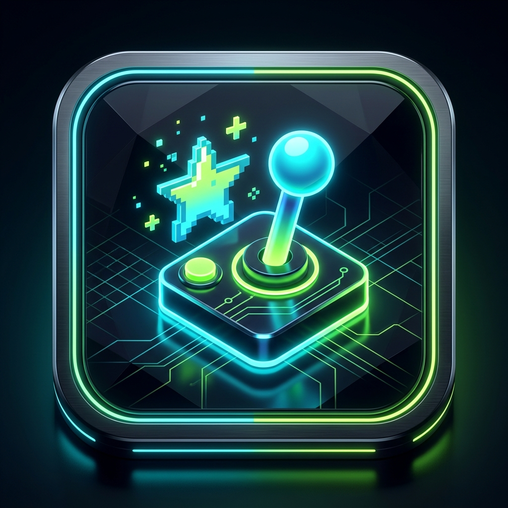
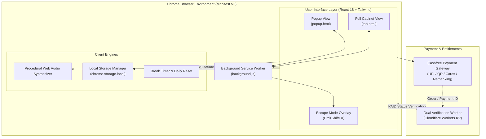

# 🕹️ SECRET ARCADE — Chrome Extension (Manifest V3)

<div align="center">



### *"Your tiny escape."*
**A compact, retro-inspired multi-game arcade hidden directly inside Google Chrome & Microsoft Edge for quick 5–20 minute breaks.**

[](https://chromewebstore.google.com/detail/secret-arcade/jckaolgojndbcidcomlbjhdmbgmaimep?authuser=0&hl=en)
[](https://microsoftedge.microsoft.com/addons/detail/secret-arcade/aonmpeobhmmlibdiodoechgkocnpncfo)

[](https://developer.chrome.com/docs/extensions/mv3/intro/)
[](https://react.dev/)
[](https://www.typescriptlang.org/)
[](https://vitejs.dev/)
[](https://tailwindcss.com/)
[](LICENSE.md)

[Chrome Web Store](https://chromewebstore.google.com/detail/secret-arcade/jckaolgojndbcidcomlbjhdmbgmaimep?authuser=0&hl=en) • [Edge Add-ons](https://microsoftedge.microsoft.com/addons/detail/secret-arcade/aonmpeobhmmlibdiodoechgkocnpncfo) • [Website Demo](website/index.html) • [Privacy Policy](PRIVACY_POLICY.md) • [Terms of Service](TERMS_OF_SERVICE.md)

</div>

---

## 🚀 Live Store Releases

Secret Arcade is published and live on both major Chromium web stores:

| Browser Store | Status | Direct Store Listing |
| :--- | :---: | :--- |
| **Google Chrome Web Store** | 🟢 **Live** | [👉 **Install for Google Chrome**](https://chromewebstore.google.com/detail/secret-arcade/jckaolgojndbcidcomlbjhdmbgmaimep?authuser=0&hl=en) |
| **Microsoft Edge Add-ons** | 🟢 **Live** | [👉 **Get for Microsoft Edge**](https://microsoftedge.microsoft.com/addons/detail/secret-arcade/aonmpeobhmmlibdiodoechgkocnpncfo) |

---

> [!NOTE]
> **Portfolio Showcase Notice**: This repository serves as the official portfolio showcase, architecture reference, and documentation hub for **Secret Arcade**. The core game engines, physics loops, and backend verification services are proprietary and closed-source.

---

## 🌟 Key Highlights

- **8 Retro Mini-Games**: Instant retro gaming directly in a lightweight browser popup or standalone full cabinet tab.
- **🛡️ Stealth Escape Mode (`Ctrl + Shift + X` / `Cmd + Shift + X`)**: Instant emergency disguise screen that auto-pauses gameplay, freezes break timers, and silences all audio.
- **⚡ Manifest V3 Compliant**: Engineered strictly under Google's latest Manifest V3 specifications with zero eval, service worker lifecycles, and minimal permissions.
- **🔒 Dual Verification Engine**: Secure payment verification supporting UPI, QR, cards, and netbanking via Cashfree Payments with instant entitlement unlocking.
- **⏱️ Healthy Break Enforcement**: Built-in 20-minute daily timer mechanics to promote productive micro-breaks without rabbit holes.
- **🔊 Web Audio API Synthesizer**: 8-bit procedural sound effects generated directly in real-time without bulky audio files.

---

## 🎮 The 8 Mini-Games Collection

| Game | Mode | Description & Mechanics |
| :--- | :--- | :--- |
| 🐍 **Neon Snake** | *Free Tier* | Classic snake reinvented with smooth vector movement, velocity ramp curves, neon food spawning, particle trails, and local high-score tracking. |
| 🧱 **Brick Breaker** | *Lifetime VIP* | Precision paddle control with plasma ball deflection physics, multi-colored brick matrix, lives system, and progressive brick resistance. |
| 🔢 **2048 Arcade** | *Lifetime VIP* | 4×4 retro neon tile matrix with keyboard arrow and tactile sliding buttons, smooth tile scaling animations, and merge score counting. |
| 💣 **Minesweeper** | *Lifetime VIP* | Guaranteed safe first-click generation, flag toggle mode, recursive zero-cascade clearing, timer, and reactive retro status faces (`🙂`, `😮`, `😎`, `😵`). |
| 🛸 **Cyber Glider** | *Lifetime VIP* | High-speed neon conduit runner navigating electrified barrier gates with thruster particle physics and dynamic obstacle pacing. |
| ⚡ **Reaction Rush** | *Lifetime VIP* | Millisecond reflex benchmark measuring visual reaction latency, precision accuracy %, and streak combo multipliers. |
| 👾 **Memory Match** | *Lifetime VIP* | 4×4 card memory challenge featuring custom retro pixel symbols (`👾`, `🕹️`, `🍒`, `⚡`, `💎`, `🛸`, `🚀`, `💣`), move counter, and timer. |
| 🏎️ **Tiny Racer** | *Lifetime VIP* | Top-down vertical 3-lane speedway racer with evasive steering, acceleration ramps, dynamic enemy vehicle spawning, and distance tracking. |

---

## 🛡️ Stealth Escape Mode (`Ctrl + Shift + X`)

Designed specifically for fast micro-breaks during work or study. One shortcut immediately conceals gameplay:

```
[ Active Game Running ] ───▶ (Press Ctrl+Shift+X or Cmd+Shift+X) ───▶ [ Instant Disguise Screen ]
                                                                             │
                                              ┌──────────────────────────────┼──────────────────────────────┐
                                              ▼                              ▼                              ▼
                                      [ Calculator ]                    [ Notes Pad ]                 [ Neutral ]
                                  (Full Functional Math)           (Auto-saving Scratchpad)     ("Ready when you are")
```

1. **Auto-Pause**: Freezes the active game loop instantly so no score is lost.
2. **Audio Mute**: Immediately cuts all audio channels and oscillators.
3. **Timer Pause**: Freezes the 20-minute gameplay session timer.
4. **4 Disguise Screens**:
   - **Calculator**: A fully interactive desktop calculator suitable for work environments.
   - **Notes**: A functional scratchpad notepad that persists notes locally.
   - **Neutral**: Professional idle screen (*"Ready when you are"* with resume button).
   - **Blank**: Pure dark screen.

---

## 🏛️ System Architecture



### Manifest V3 & Security Principles
- **No Remote Code Execution**: All application logic and assets are bundled locally into the extension package, strictly adhering to Chrome Web Store security guidelines.
- **Minimal Permissions Philosophy**: Only requires the `storage` permission for persisting high scores, settings, and unlock status. No invasive permissions (`<all_urls>`, `tabs`, `cookies`, or `webRequest`).
- **Zero Trackers**: 100% offline-capable with zero external tracking scripts, advertising SDKs, or behavioral telemetry.

---

## 💳 Payment & Dual Verification Flow

To provide a seamless upgrade without requiring traditional account passwords:

1. **Checkout**: User completes a one-time purchase of ₹299 on the official Cashfree checkout form via UPI, Cards, or Netbanking.
2. **Receipt Credentials**: Cashfree generates an Order ID / Payment Reference ID and sends an email receipt.
3. **In-App Verification**: The user enters their email and Cashfree Order/Payment ID.
4. **Instant Unlock**: The entitlement engine verifies the transaction status against the API, permanently unlocking all 8 games and themes in `chrome.storage.local`.

---

## 💻 Tech Stack & Modern Tooling

| Component | Technology | Purpose |
| :--- | :--- | :--- |
| **Framework** | React 18 + TypeScript | Componentized UI architecture, modular state handling, and type safety |
| **Bundler** | Vite 5 | Lightning-fast HMR and optimized tree-shaken production bundles |
| **Styling** | Tailwind CSS 4 + PostCSS | Retro aesthetic, responsive layout, and CRT scanline effects |
| **Audio** | Web Audio API | Procedural sound generation without external audio assets |
| **Graphics** | HTML5 Canvas API | High performance 60 FPS rendering for arcade physics |
| **Platform** | Manifest V3 (Chrome & Edge) | Modern service worker lifecycle & shortcut commands |
| **Backend** | Cloudflare Workers + KV | Serverless webhook and payment verification endpoint |

---

## 📂 Project Structure (Showcase Layout)

```text
secret-arcade/
├── public/                     # Static assets & Manifest V3 configuration
│   ├── icons/                  # 16px, 32px, 48px, 128px extension icons
│   └── manifest.json           # Chrome Manifest V3 schema definition
├── store-assets/               # Store promotional graphics & banners
├── website/                    # Landing page & showcase web portal
│   └── index.html              # Responsive marketing page
├── scripts/                    # Build & packaging utilities
│   ├── generate-icons.js       # Procedural PNG icon generator
│   └── package-extension.js    # Chrome Web Store packaging script
├── CHROME_STORE_PUBLISHING_GUIDE.md
├── EDGE_ADDONS_PUBLISHING_GUIDE.md
├── CLOUDFLARE_SETUP_GUIDE.md
├── PRIVACY_POLICY.md
├── TERMS_OF_SERVICE.md
├── package.json                # Dependencies & build scripts
├── tsconfig.json               # TypeScript compiler configuration
├── vite.config.ts              # Vite bundling pipeline
├── popup.html                  # Extension popup entry point
└── tab.html                    # Standalone full cabinet view
```

---

## 📄 Documentation & Publishing Guides

- 📘 [Chrome Web Store Publishing Guide](CHROME_STORE_PUBLISHING_GUIDE.md)
- 🌐 [Microsoft Edge Add-ons Publishing Guide](EDGE_ADDONS_PUBLISHING_GUIDE.md)
- ☁️ [Cloudflare Verification Worker Setup](CLOUDFLARE_SETUP_GUIDE.md)
- 🔒 [Privacy Policy](PRIVACY_POLICY.md)
- ⚖️ [Terms of Service](TERMS_OF_SERVICE.md)

---

## 👤 Author & Inquiries

**Developed by Anvith Gopa**  
GitHub: [@Anvithgopa](https://github.com/Anvithgopa)

---

## ⚖️ License & Proprietary Rights

Copyright © 2026 Anvith Gopa. All rights reserved.  
The core source code, game engines, and graphic assets are proprietary and closed-source. See [LICENSE.md](LICENSE.md) for full terms.
